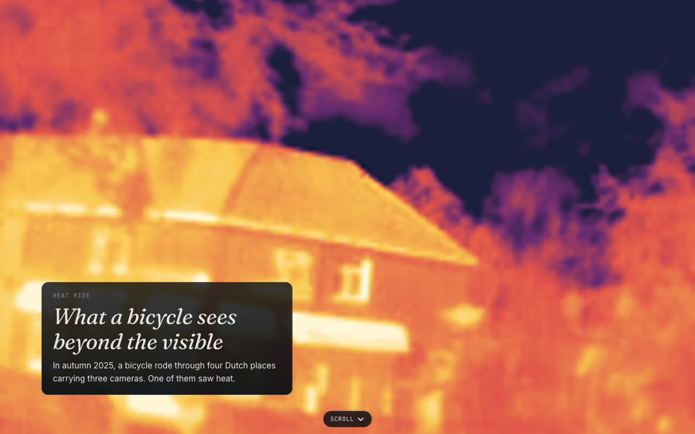

# Street Skin
### What a bicycle sees beyond the visible

A scroll story that rides through four Dutch places, from a village to a city, with three cameras (normal colour, near-infrared, thermal), and asks one question: **do greener streets run cooler?**

**Live:** not published yet (will be https://nirmitsachde.github.io/street-skin/) · **Video (60 s):** [video/street-skin-60s.mp4](video/street-skin-60s.mp4) · **Write-up:** [docs/WRITEUP.md](docs/WRITEUP.md)



## The finding
Greener streets were only a little cooler, and only in two of the four places. In the town (Oirschot) and the small city (Delft), every extra tenth of green in view came with about a quarter of a degree less warmth. In the big city (Arnhem) and the village (Middelbeers), once the bike's direction relative to the sun is accounted for, green made no clear difference. It was October: shade does most of its work in summer. The story ends with the ten warm, bare street stretches where a tree would help most.

## How it works
- `pipeline/`: Python 3.12 (uv). Streams 5,192 photo triplets out of a 34 GB Zenodo archive with HTTP range requests (several photos per request to stay under the rate limit), measures green view from near-infrared (NDVI) and surface warmth from thermal, adds hourly weather (Open-Meteo), snaps photos to OpenStreetMap streets, tests the question with a street-level bootstrap, picks and privacy-blurs the published photos, and exports the web data. Run everything with `pipeline/run_all.sh`.
- `web/`: Vite, vanilla JS, MapLibre GL + deck.gl (TripsLayer, ScatterplotLayer, PathLayer), scrollama, D3, p5.js. One requestAnimationFrame master clock, capped at 30 fps. `?autoplay=1` plays the story hands-free (used for the video).
- `docs/`: [brief](docs/BRIEF.md), [data contract](docs/DATA_CONTRACT.md), [write-up](docs/WRITEUP.md).

```
cd web && npm ci && npm run dev
```

## Honest notes (also on the page)
- The thermal camera reads about 16 C above the air even under full cloud, so absolute temperatures are not used. Warmth is relative: each spot against the other streets ridden in the same place in the same hour.
- The thermal camera mostly sees facades, trees and cars, not the road itself, so the measure is the warmth of the street's surfaces ("skin"), not road temperature.
- 23% of near-infrared photos were too dark to measure plants (mostly Arnhem's first day) and are left out of plant measures.
- Autumn, around midday, one or two days per place. Findings are per street stretch, never per person or house. Only ~230 normal-colour photos are published, small, with faces and plates blurred.

## Usability test
See [docs/USABILITY.md](docs/USABILITY.md).

## Credits
- Spectrascapes dataset: Gupta, Timmermans, Biljecki, Uijlenhoet (2026). DOI [10.5281/zenodo.19440802](https://doi.org/10.5281/zenodo.19440802). CC BY 4.0.
- Streets: © OpenStreetMap contributors (ODbL). Weather: Open-Meteo. Basemap: © CARTO.

Code: MIT.
